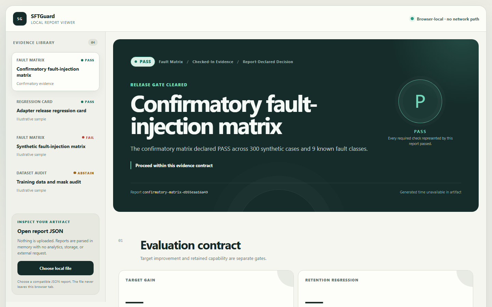
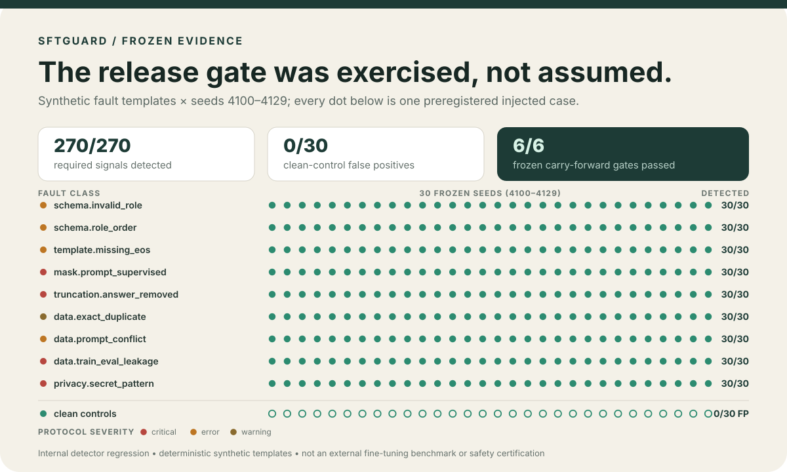

# SFTGuard

[](https://github.com/Labeeb2339/sftguard/actions/workflows/ci.yml)
[](https://github.com/Labeeb2339/sftguard/actions/workflows/codeql.yml)
[](LICENSE)

**Fail-closed preflight and regression CI for supervised fine-tuning.**



*This is the actual browser-local report viewer rendering the
[v0.1 evidence file](evidence/v0.1.0-confirmatory.json). The fixed-viewport
capture and its source are reproducible with
[`scripts/capture_readme_dashboard.py`](scripts/capture_readme_dashboard.py).*

SFTGuard catches a specific set of pipeline mistakes that are expensive to
discover after an adapter ships: malformed chat records, conflicting or leaked
examples, credential-shaped text, broken EOS handling, prompt tokens included
in loss, and answer-destroying truncation. It then gates paired
base-versus-adapter scores against explicit target and retention budgets.

It runs locally, emits hashed JSON, and returns `PASS`, `FAIL`, or `ABSTAIN`.
Missing evidence never becomes a silent pass.

## Why this exists

A training job can complete while optimizing the wrong tokens, leaking an
evaluation prompt into training, or degrading a capability that was not the
fine-tuning target. Training loss alone does not answer those questions.
SFTGuard turns the checks that *can* be established deterministically into a
small set of release checks:

```text
local JSONL + exported token/mask evidence ──> audit ──> PASS / FAIL / ABSTAIN
paired base + adapter evaluation records ───> gate  ──> Regression Card
                                                       └──> CI exit code + viewer
```

## Try it in two minutes

SFTGuard requires Python 3.11 or newer and has no runtime dependencies.

```bash
git clone https://github.com/Labeeb2339/sftguard.git
cd sftguard
python -m venv .venv

# Windows PowerShell
.venv\Scripts\Activate.ps1

# macOS / Linux
# source .venv/bin/activate

python -m pip install -e .
sftguard demo --output artifacts/local/demo.json
```

The demo is deterministic and uses synthetic records only. Exit codes are
`0 = PASS`, `1 = FAIL`, and `2 = ABSTAIN`.

Audit the checked-in safe fixtures:

```bash
sftguard audit \
  --train examples/clean-train.jsonl \
  --eval examples/clean-eval.jsonl \
  --output artifacts/local/audit.json
```

Gate paired base and adapter evaluation evidence:

```bash
sftguard gate \
  --base examples/base-eval.jsonl \
  --adapter examples/adapter-eval.jsonl \
  --contract examples/regression-contract.json \
  --output artifacts/local/regression-card.json
```

## Exact mask evidence, not a heuristic

The data checks accept ordinary `messages` records. Template, EOS, truncation,
and loss-mask claims require an `_sftguard` annotation exported from the exact
tokenization/collation path used for training:

```json
{
  "messages": [
    {"role": "user", "content": "Classify this."},
    {"role": "assistant", "content": "class_a"}
  ],
  "_sftguard": {
    "token_ids": [10, 20, 30, 2],
    "token_roles": ["user", "user", "assistant", "assistant"],
    "loss_mask": [false, false, true, true],
    "eos_token_id": 2,
    "original_assistant_tokens": 2,
    "truncated": false
  }
}
```

v0.1 intentionally does **not** guess an assistant mask or claim direct
integration with Transformers, TRL, Axolotl, or LLaMA-Factory. If trustworthy
mask evidence is missing or malformed, the full audit returns `ABSTAIN`. The
`MaskInspector` protocol in `src/sftguard/tokenizer.py` is the extension point
for trainer-specific exporters.

For compatible Hugging Face templates, a future adapter can use
`apply_chat_template(..., tokenize=True, return_dict=True,
return_assistant_tokens_mask=True)` only when the template marks assistant spans
with ``. Until that adapter is implemented and tested, it is not
part of SFTGuard's claims.

## Regression Cards

The gate pairs base and adapter measurements by seed, sample ID, group, and
metric. A contract declares:

- a minimum confidence-bound improvement for each `target` metric;
- a maximum confidence-bound regression for each `retention` metric; and
- the bootstrap draw count, confidence level, and deterministic seed.

SFTGuard normalizes lower-is-better metrics, resamples seed clusters with a
fixed xorshift32 stream, and applies the threshold to the lower confidence
bound. Unpaired, duplicated, undeclared, non-finite, or incomplete evidence
returns `ABSTAIN`.

The fixed joint work budget also returns `ABSTAIN` before an extreme
draw-count × pair-count request can consume unbounded CPU time.

### Put the gate in GitHub Actions

```yaml
name: SFT preflight
on: [push, pull_request]

jobs:
  sftguard:
    runs-on: ubuntu-latest
    steps:
      - uses: actions/checkout@v7
      - uses: actions/setup-python@v6
        with:
          python-version: "3.11"
      - run: python -m pip install git+https://github.com/Labeeb2339/sftguard.git
      - run: >-
          sftguard audit
          --train data/train.jsonl
          --eval data/eval.jsonl
          --output artifacts/sftguard-audit.json
```

The command's exit code blocks `FAIL` and `ABSTAIN` by default. Keep private
datasets out of Actions artifacts unless their disclosure is explicitly safe.

## Static report viewer

The viewer is a static React application with no analytics, report endpoint,
external font, or server-side storage. An imported report stays in the current
browser tab.

```bash
cd web
npm ci
npm run dev
```

It accepts the native audit, Regression Card, development-benchmark, and
confirmatory schemas. The viewer treats a supplied digest as **declared but
unverified** because it cannot promise byte-for-byte parity with Python's
canonical JSON serializer. Use the Python verifier for an integrity attestation.

## Pre-set evidence

The v0.1 fault plan was committed before confirmatory seeds were generated or
inspected. It fixes nine single-fault templates, seeds `4100–4129`, six
carry-forward checks, and the allowed claim. The implementation and one-shot
evidence runner are committed and pushed before the confirmatory run.



I generate this matrix directly from the evidence file with the checked-in
renderer. Every dot is one pre-set case; marker colour is the plan severity,
not model confidence. The result is internal detector regression evidence, not
an external fine-tuning benchmark or safety certification.

- [Protocol](docs/FAULT_INJECTION_PROTOCOL.md)
- [Product specification](docs/PRODUCT_SPEC.md)
- [Evidence runner](scripts/confirmatory_evidence.py)
- [Evidence reproduction guide](docs/EVIDENCE.md)
- [Confirmatory result summary](docs/RESULTS.md)
- [Related work and boundaries](docs/RELATED_WORK.md)

The matrix is an **internal detector regression**: each seed changes synthetic
markers, while each fault class keeps the same structural injection template.
It is not 30 independent real-world datasets, an external benchmark, a safety
certification, or proof that SFTGuard catches unknown failures.

Checked-in confirmatory evidence is added only after the runner verifies a clean
and pushed implementation commit and reproduces the artifact in two fresh
processes. The result is preserved even if a check fails.

### v0.1 confirmatory result

All six carry-forward checks passed without post-result changes:

| Measure | Check | Observed |
| --- | ---: | ---: |
| Critical fault recall | 100% per class | **100%** |
| Macro recall, nine fault classes | ≥ 90% | **100%** |
| Clean-control false-positive rate | ≤ 10% | **0 / 30 (0%)** |
| Fault injections detected | — | **270 / 270** |
| Fresh-process reproduction | byte-identical | **matched** |
| Raw synthetic text in report | none | **none detected** |

`carry_forward: true` across 300 synthetic cases. Protocol commit:
`d4c74cefca6729124142635dc8893b5e3ddec2d3`. Implementation commit:
`b0f168ab4d6a959d4e28611e345a250c14ca2ea9`.

- [Confirmatory evidence](evidence/v0.1.0-confirmatory.json)
- [Evidence manifest](evidence/v0.1.0-confirmatory.manifest.json)
- Raw artifact SHA-256:
  `961b2842d7791f6f3af7bec5bce6105e433b68d41bf6f7b82a9f3a98e1f695ab`
- Canonical payload SHA-256:
  `eb55eaa16a492881ff1bcec8812b2ef37bb2ed6055b6b90a1da408386f632e3a`

This supports the pre-set synthetic-detector statement only. It is not a claim
that 300 varied real-world fine-tuning pipelines were evaluated.

## Privacy and security

- Files are bounded and parsed as untrusted UTF-8 JSON/JSONL.
- Findings contain signal categories and bounded locations, not dataset text.
- Reports contain aggregate values and hashes; hashes are identifiers, **not
  anonymization**.
- The repository contains no model weights, adapters, private datasets,
  private prompt/response content, or real credentials. Example conversations
  and credential-shaped test strings are synthetic.
- Do not publish a real report until you have followed the
  [safe-sharing checklist](docs/SHARING.md).

See [SECURITY.md](SECURITY.md) for private vulnerability reports.

## What SFTGuard does not prove

SFTGuard does not train a model, score dataset quality, predict fine-tuning
success, detect every secret, replace a real evaluation harness, or establish
that an adapter is generally safe. A Regression Card is valid only for the
records and thresholds supplied to it.

## Develop

```bash
python -m pip install -e ".[dev]"
python -m pytest
python -m ruff check src tests/python scripts
python -m ruff format --check src tests/python scripts
python scripts/generate_readme_assets.py --check

cd web
npm ci
npm run check
```

Contributions that add a detector should include a minimal fault fixture, a
clean control, redaction tests, and a clear scope note. Start with
[CONTRIBUTING.md](CONTRIBUTING.md) and the [roadmap](docs/ROADMAP.md).

## License and citation

Apache-2.0. Citation metadata is available in [CITATION.cff](CITATION.cff).
