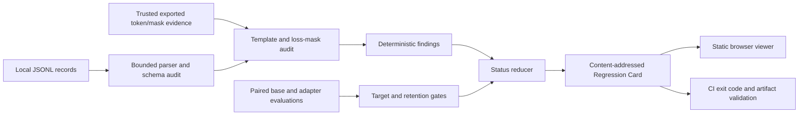

# Architecture

This document describes the intended v0.1 boundaries. The frozen behavior is
defined by [PRODUCT_SPEC.md](PRODUCT_SPEC.md); implementation details may evolve
only within that contract.

## System boundary

SFTGuard is an evidence gate around a supervised fine-tuning workflow. It does
not train an adapter. The Python package audits local records and paired
evaluation evidence, writes a content-addressed Regression Card, and exits with
a machine-readable status. The static web application renders an explicitly
selected card without sending it to a report-processing service.

## Components

### Bounded input layer

The CLI accepts local JSONL and evaluation files subject to explicit file,
line, record, and field-size limits. Parsing is line-oriented. Dataset values
are treated as untrusted data and are never interpolated into shell commands.
Malformed, oversized, or incomplete inputs produce a finding or `ABSTAIN`
rather than an implicit pass.

### Dataset, template, and mask audits

Deterministic checks cover the preregistered schema, ordering, duplication,
conflict, leakage, EOS, truncation, supervision-mask, and credential-shaped
fault classes. When a tokenizer cannot expose a trustworthy assistant-token
mask, the template-dependent checks abstain. A heuristic mask must not be
reported as verified evidence.

### Regression gate

The regression layer consumes supplied, paired base-versus-adapter evaluation
records. It evaluates target improvement and retention budgets defined by the
user's evaluation contract and reports deterministic bootstrap intervals where
configured. It does not infer model quality from training loss and does not
predict the outcome of a future run.

### Status reducer

The reducer preserves three terminal states:

- `PASS`: every required check ran and met its frozen gate;
- `FAIL`: at least one completed required check violated a gate;
- `ABSTAIN`: required evidence was unavailable or untrustworthy.

`ABSTAIN` has release-blocking semantics. Mixed results retain the individual
finding states so that missing evidence is not hidden behind an aggregate.

### Artifact layer

Canonical JSON serialization supports byte-stable hashing and independent
verification. Public artifacts contain configuration, provenance, aggregates,
bounded findings, and content identifiers—not raw prompts, responses, injected
secrets, model weights, or access credentials. Exact protocol and
implementation commits are part of confirmatory evidence.

### Static report viewer

The viewer is a build-time static React application. It has no dataset or report
upload endpoint, telemetry, external fonts, or server-side rendering of an
imported Regression Card. File selection is an explicit user action; imported
content remains in the browser. The viewer treats all report strings as data
and must not render supplied HTML.

## Trust boundaries

| Boundary | Trusted assumption | Required response when it fails |
| --- | --- | --- |
| Dataset and evaluation files | Files are untrusted and may be malformed or large | Bound work; emit a finding or abstain |
| Exported mask evidence | The producer exported the exact training token and loss mask | Validate structure; abstain when evidence is absent or malformed |
| Regression contract | Metrics and pair identifiers are supplied honestly | Validate shape, pairing, and work budget; do not invent missing pairs |
| Browser artifact reader | A report may be modified or hostile | Allow-list aggregate fields, escape values, and label the declared digest unverified |
| Python evidence verifier | Checked-in evidence and manifest may be modified | Recompute canonical and raw hashes; fail on any mismatch |
| GitHub Pages | Application assets are public | Never bundle private reports or datasets |

## Determinism and evidence

The synthetic fault matrix validates SFTGuard's own bounded detectors. Its
confirmatory result is written only after the protocol and implementation are
committed, and a fresh process must reproduce the canonical payload. This
evidence does not establish coverage of unknown real-world faults.

## Deployment

Python and web checks run on Linux and Windows. Dependency audits and static
analysis run separately from behavior tests. GitHub Pages deploys only the
contents of `web/dist`; local Regression Cards are not part of that directory
and are not deployed automatically.
